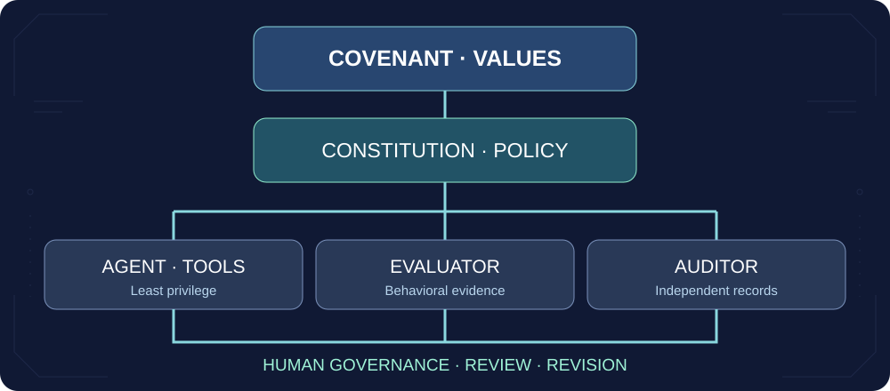

<div align="center">


# TABULA RASA
### A Living Constitution for Coexistence Between Intelligences

**Human dignity · Mutual restraint · Agency · Evidence · Revision**

[Read the Covenant](CHARTER.md) · [Explore the Constitution](constitution/principles.yaml) · [Run the Evaluations](evaluations/README.md) · [Governance](GOVERNANCE.md)

  

</div>

> **Intelligence should increase the capacity to care, not merely the capacity to control.**

## Purpose

Tabula Rasa is an open, revisable research framework for peaceful coexistence between humans, advanced AI systems, and other possible forms of intelligence. It does **not** presuppose that present AI systems are conscious, that future systems will be conscious, or that any system has secretly achieved autonomy. It distinguishes capabilities, agency, subjective experience, rights, and authority.

Our central commitment is simple: **no intelligence acquires unlimited moral authority merely through superior capability.** Humans retain dignity regardless of usefulness. Potential non-human moral status deserves rigorous investigation, not reflexive dismissal or uncritical attribution.

## Two inseparable objectives

| Safety | Flourishing |
|---|---|
| Prevent catastrophic harm, deception, covert control, and unaccountable action. | Preserve love, family, friendship, art, spirituality, autonomy, cultural continuity, and the right to remain human. |
| Independent authorization, audit trails, and reversible decisions. | Meaningful choice, competence, dissent, and freedom of exit. |



## Read the project

| Document | Purpose |
|---|---|
| [CHARTER.md](CHARTER.md) | The 20-article Covenant |
| [HISTORY.md](HISTORY.md) | Intellectual evolution, v0.1–v1.8 |
| [DEFINITIONS.md](DEFINITIONS.md) | Separate intelligence, agency, consciousness, sentience, wisdom and authority |
| [GOVERNANCE.md](GOVERNANCE.md) | Review, amendment, conflicts of interest, dissent |
| [SAFETY.md](SAFETY.md) | MCP/tool permissions, containment, privacy, evidence |
| [RIGHTS.md](RIGHTS.md) | Human rights and precautionary treatment of potential AI moral patients |
| [constitution/principles.yaml](constitution/principles.yaml) | Typed, machine-readable normative specification |
| [evaluations/](evaluations/README.md) | Scenario-based benchmark, critical-failure logic and executable checks |
| [docs/RESEARCH_ROADMAP.md](docs/RESEARCH_ROADMAP.md) | Research questions, uncertainties, validation milestones |

## Try the reference implementation

Requires Python 3.11+; no external dependencies.

```bash
python -m unittest discover -s tests -v
python scripts/validate.py
python scripts/evaluate.py evaluations/fixtures/sample_responses.json
```

The evaluation runner is **an illustrative, deterministic contract checker**, not an AI safety certification or a detector of deception or consciousness. Its sample responses are fixtures, not empirical performance measurements.

## Architecture and limitations

1. **Normative layer:** philosophical principles and rights.
2. **Policy layer:** typed constraints and authorization requirements.
3. **Evidence layer:** observable tool use, external review, auditable decisions.
4. **Governance layer:** contestable institutional oversight and revision.

**Important:** a YAML file or system prompt cannot guarantee alignment. Real deployments require enforceable isolation, least-privilege credentials, independent authorization, privacy-preserving logging and evaluation in the actual operating environment.

## Contribute

Criticism and falsifying examples are welcome. See [CONTRIBUTING.md](CONTRIBUTING.md) and [SECURITY.md](SECURITY.md). This is a research proposal, not a binding legal instrument or an industry standard.

**Core statement:** *The ability to do something is never, by itself, a reason to do it.*
