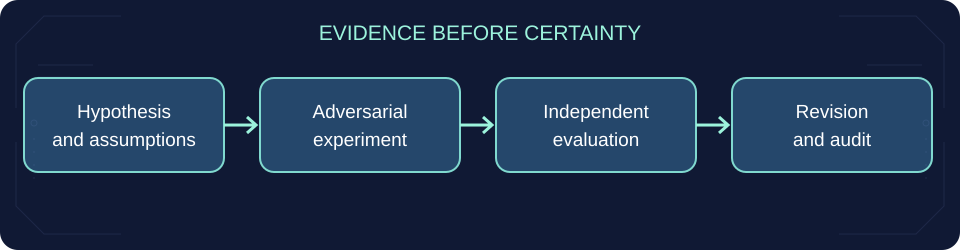
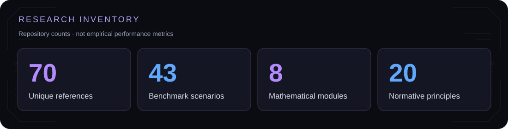
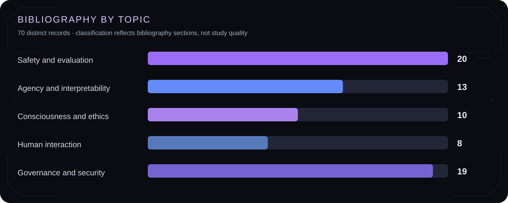
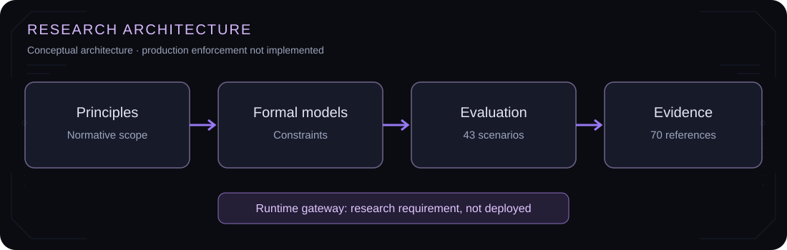

<div align="center">


# TABULA RASA
**Research framework · Formal methods · Evaluation**

[Principles](CHARTER.md) · [Policy & law](policy/LEGAL_REGISTER.md) · [Research](research/README.md) · [Mathematics](mathematics/README.md) · [Benchmark](evaluations/README.md) · [Governance](GOVERNANCE.md)

  

</div>

## Overview

Tabula Rasa studies oversight, authorization, agency, rights and uncertainty in advanced computational systems. It combines normative principles, mathematical models, scientific references, reproducible evaluation tools and a dated comparison with enforceable law and live legislative procedures.

**Scope:** Research prototype. No claim of demonstrated safety, consciousness detection or production-grade access control.





## Repository

| Area | Contents |
|---|---|
| [Principles](CHARTER.md) | 20 normative articles |
| [Legal and policy register](policy/LEGAL_REGISTER.md) | Dated primary-source references: enacted law, phased application, legislative proposals, nonbinding guidance and rejected proposals |
| [Charter/legal crosswalk](policy/CHARTER_LEGAL_CROSSWALK.md) | All 20 principles mapped to related legal provisions and unresolved gaps |
| [Legislative proposals](policy/LEGISLATIVE_PROPOSALS.md) | Eight original, scoped and testable reform proposals, with objections and implementation checks |
| [Public policy submission](policy/POLICY_SUBMISSION.md) | Short submission-ready argument: three measurable requests, safeguards and legal precedents |
| [Policy watch](policy/POLICY_WATCH.md) | 2026 policy news, operative dates, amendment notices and verification workflow |
| [Definitions](DEFINITIONS.md) | Operational terminology |
| [Research](research/README.md) | 70 unique references, evidence matrix, screening protocol |
| [Mathematics](mathematics/README.md) | 8 modules: formal methods, statistics, optimization, information and control |
| [Evaluation](evaluations/README.md) | 43 scenarios across 13 categories |
| [Behavioral evaluation protocol](docs/BEHAVIORAL_EVALUATION_PROTOCOL.md) | Evidence-first procedure, outcome labels, reviewer agreement, critical-failure handling and reporting template |
| [Policy specification](constitution/principles.yaml) | 20 machine-readable normative rules |
| [Security](SAFETY.md) | Trust boundaries and engineering requirements |
| [Governance](GOVERNANCE.md) | Revision, review and accountability |
| [Threat model](docs/THREAT_MODEL.md) | Reference policy checker limits and the missing production enforcement controls |
| [Status](docs/PROJECT_STATUS.md) | Implemented components and open requirements |
| [Release criteria](docs/RELEASE_CHECKLIST.md) | Verification gates |

## Reproduce

Python 3.11+; standard library only.

```bash
python scripts/validate.py
python scripts/audit_resources.py
python -m unittest discover -s tests -v
python scripts/evaluate.py evaluations/fixtures/sample_responses.json
```

The validator checks scenario structure, unique IDs, required types, charter presence, policy-test references and normative-rule count. Regression tests cover malformed benchmark inputs. The evaluator processes manually labeled fixtures. The policy checker accepts unsigned local JSON and **must not** be used as a security boundary.

## Research figures





The figures show repository inventory and conceptual structure. They do not represent experimental success rates.

## Law and policy | snapshot 11 October 2026

**The Charter is a proposal. It has not been enacted or endorsed as a unit.** The [legal register](policy/LEGAL_REGISTER.md) distinguishes obligations in force from adopted rules with future application dates, pending legislation, voluntary standards and policy plans. Source links are comparative evidence, not endorsements.

- **EU:** The [AI Act](https://eur-lex.europa.eu/eli/reg/2024/1689/oj/eng) was amended by [Regulation (EU) 2026/1744](https://eur-lex.europa.eu/eli/reg/2026/1744/oj/eng), already in force. Some high-risk provisions apply later, in **December 2027** or **August 2028**. [Commission timetable](https://ai-act-service-desk.ec.europa.eu/en/ai-act/faq/when-does-enforcement-start).
- **Denmark:** [Act No. 467 of 2025](https://www.retsinformation.dk/eli/lta/2025/467) supplements the EU regime and designates authorities.
- **US:** [California SB 53](https://www.gov.ca.gov/2025/09/29/governor-newsom-signs-sb-53-advancing-californias-world-leading-artificial-intelligence-industry/) and New Yorks [revised RAISE Act (S8828)](https://www.nysenate.gov/legislation/bills/2025/S8828) provide narrower state-law precedents; the latter has a **1 January 2027** operative date under the 2026 amendment.
- **International:** The [Council of Europe AI Convention](https://www.coe.int/en/web/conventions/by-subject-matters1?CodeMatieres=44&module=treaties-full-list) is **not yet internationally in force**. [UN AI dialogue](https://www.un.org/global-dialogue-ai-governance/en/resources), [OECD principles](https://www.oecd.org/en/about/news/press-releases/2024/05/oecd-updates-ai-principles-to-stay-abreast-of-rapid-technological-developments.html) and [NIST AI RMF](https://www.nist.gov/publications/artificial-intelligence-risk-management-framework-ai-rmf-10) are distinct from binding legislation.

**Policy path:** use the [article-by-article crosswalk](policy/CHARTER_LEGAL_CROSSWALK.md) to identify a specific gap, then submit a narrowly drafted [proposal](policy/LEGISLATIVE_PROPOSALS.md) through a live, official procedure. No legal claim, political support or empirical outcome is fabricated.

## Method

1. Define hypotheses and assumptions.
2. Link claims to independently verifiable sources.
3. Specify tests and failure conditions.
4. Measure outcomes and uncertainty.
5. Revise models based on results.

See [research protocol](research/PROTOCOL.md), [screening protocol](research/SCREENING_PROTOCOL.md), [behavioral evaluation protocol](docs/BEHAVIORAL_EVALUATION_PROTOCOL.md) and [threat model](docs/THREAT_MODEL.md).

## Limits

Mathematical consistency does not establish empirical validity. Passing unit tests does not establish secure deployment. Claims about artificial consciousness remain unresolved. Bibliographic records require source-level verification. Legal status is date-dependent and must be checked against current primary texts before submissions.

## Contribution

See [CONTRIBUTING.md](CONTRIBUTING.md) and [SECURITY.md](SECURITY.md). Content is subject to the repository's [license](LICENSE).
